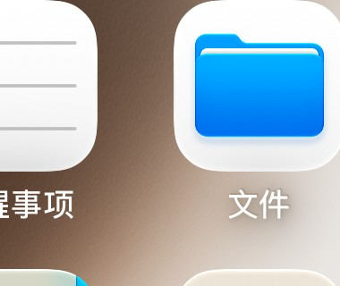
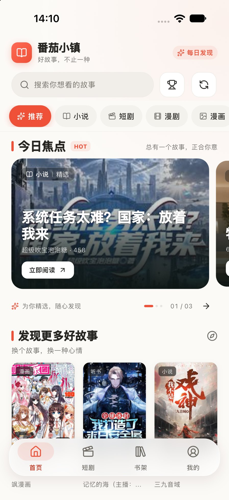

<p align="center">
  
</p>

<h1 align="center">番茄小镇 · fqapp iOS</h1>

<p align="center">
  <strong>fqapp（Android）的非官方 iOS 移植版</strong><br>
  Flutter + Rust + Swift · 小说 / 短剧 / 漫剧 / 漫画 / 听书
</p>

> ## 来源声明
>
> 本项目是 GitHub 上 **[ch6vip/fqapp](https://github.com/ch6vip/fqapp)** 的 **非官方 iOS 移植版**。
>
> - 上游是一个面向 **Android** 的 Flutter + Rust 内容聚合客户端，**上游 README 明确说明没有 iOS 版**。
> - 本仓库的 Dart UI、Rust 核心、资源与测试来自上游源码快照
>   `e43762d0ba9b192b5e8cb7db24a5b6e06f2216e3`，按 **GPL-3.0** 继续开源。
> - Android 侧的 Kotlin 平台层已在本仓库中改写为 Swift；iOS Runner、CENC 播放方案和
>   iOS 构建/签名脚本为本仓库新增。
> - 本项目与上游作者**没有隶属或授权关系**，不代表上游官方立场。
> - 原样保留的上游说明见 [`README-UPSTREAM.md`](README-UPSTREAM.md)，修改清单见
>   [`NOTICE.md`](NOTICE.md)。



## 这是什么

这是把 fqapp 的 Flutter UI 与 Rust 核心真正编译到 iOS 的移植版，不是 Android 模拟器、
不是 WebView 套壳：

- UI：同一份 Flutter/Dart 页面，使用 Flutter iOS 引擎原生渲染；
- 核心：同一份 Rust 业务逻辑，编译为 `fqapi_core.framework`（arm64 iOS）；
- 平台层：Android 的 Kotlin 插件全部改写为 Swift（AVPlayer、AVSpeechSynthesizer、
  UIKit、UniformTypeIdentifiers 等）；
- 播放：AVPlayer + FlutterTexture；CENC 媒体由 Rust 解密后交给 AVPlayer；
- 打包：iOS `.app` / IPA，不含 Android 运行时、APK、DEX 或 `.so`。

## 功能

| 功能 | 状态 |
| --- | --- |
| 首页推荐、分类、搜索、详情、评论 | ✅ |
| 小说阅读（分页/滚动、排版、章节、缓存） | ✅ |
| 短剧 / 漫剧 / 听书（CENC、倍速、续播） | ✅ |
| 漫画阅读 | ✅ |
| 系统朗读（AVSpeechSynthesizer） | ✅ |
| 阅读亮度、常亮、字体导入 | ✅ |
| TXT 导出、系统分享、备份导入导出 | ✅ |
| 后台音频 / 锁屏控制 | ✅ 已实现，真机待人工验收 |
| 音量键翻页 | ❌ iOS 不提供应用级拦截 |
| 海信墨水屏全刷 | ❌ 仅 Android 厂商接口 |

## 架构

```text
┌──────────────────────────── iPhone (iOS 17+) ────────────────────────────┐
│  Flutter/Dart UI (lib/)  ── Flutter iOS engine (Metal/Impeller)          │
│        │ flutter_rust_bridge (FFI)                                       │
│  fqapi_core.framework (Rust, arm64 iOS)                                  │
│        │ 设备注册 / 上游签名 / 回环 HTTP / CENC 解密 / 缓存               │
│  Swift 平台层 (ios/Runner/)                                              │
│        ├─ AVPlayer + FlutterTexture                                      │
│        ├─ AVSpeechSynthesizer                                            │
│        ├─ UIScreen / UIDevice / UIDocumentPicker                          │
│        └─ UIActivityViewController / Keychain                            │
└──────────────────────────────────────────────────────────────────────────┘
```

### 与 Android 版的差异

| 层 | Android 上游 | 本仓库 iOS |
| --- | --- | --- |
| UI | Flutter/Dart | 同一份 Dart，Flutter iOS 引擎 |
| 平台插件 | Kotlin/Java | Swift |
| 播放器 | ExoPlayer + CENC DataSource | AVPlayer + Rust 解密缓存 |
| 系统朗读 | Android TextToSpeech | AVSpeechSynthesizer |
| 核心库 | `libfqapi_core.so`（ELF） | `fqapi_core.framework`（Mach-O） |
| 包格式 | APK | `.app` / IPA |

CENC 短剧/听书在 iOS 上的处理：`NativePlayer.create(url, keyHex)` 会先让 Rust 把整集
下载（或读取离线文件）并解密到 `Library/Caches/media_cache/`，再交给 AVPlayer 播放。
首次播放会等待整集解密；明文缓存不进 iCloud 备份，系统可回收。

## 构建

### 前置

- macOS + Xcode 27（iOS 17+ SDK）
- Flutter 3.47.x / Dart 3.13.x
- Rust stable，安装 iOS 目标：
  ```bash
  rustup target add aarch64-apple-ios aarch64-apple-ios-sim x86_64-apple-ios
  ```
- CocoaPods 1.15.2+（Ruby 2.6 环境的 `RUBYOPT=-rlogger` 处理见 [`IOS_PORT.md`](IOS_PORT.md)）

### 步骤

```bash
flutter pub get
./scripts/build_rust_ios.sh          # 生成 ios/fqapi_core/fqapi_core.xcframework
cd ios && pod install && cd ..
flutter build ios --simulator --debug
```

`fqapi_core.xcframework` 是构建产物，**不提交到仓库**；首次构建必须先跑
`scripts/build_rust_ios.sh`。

### 真机安装

仓库不含任何签名证书、描述文件或已签名 IPA。推荐用 Xcode 自动签名：

1. 打开 `ios/Runner.xcworkspace`；
2. Runner → Signing & Capabilities，勾选自动签名并选择你的 Team；
3. 把 Bundle Identifier 改成你自己的唯一值（当前示例为 `com.weixiaoxun.fqapp`）；
4. 连接 iPhone 后 Run。

也可以使用 `scripts/install_to_iphone.sh`（需要本机 Xcode 已登录 Apple ID）：

```bash
./scripts/install_to_iphone.sh
```

完整的签名、续签、无线调试和排错说明见 **[IOS_PORT.md](IOS_PORT.md)**。

## 已验证

- 模拟器 iPhone 18 Pro（iOS 27）冷启动，Rust 核心 `running` / `backend healthy`，
  首页从真实上游加载；
- 集成测试覆盖：首页/短剧/书架切换、真实短剧 CENC 内联播放、AVPlayer → FlutterTexture、
  AVSpeechSynthesizer、阅读亮度、真实小说阅读页、TXT 导出；
- Rust 离线 CENC 夹具验证 `prepare_media` 解密结果与独立实现一致；
- 相关 Dart 单元测试 68 个通过；
- 真机 iPhone 安装、签名、启动并加载首页（详细记录见 IOS_PORT.md）。

## 目录

```text
lib/                 Flutter 页面、服务、模型（来自上游）
rust/                Rust 核心（来自上游 + iOS media_cache）
native/              Android C 加密核心（上游）
android/             Android 工程（上游）
ios/                 iOS Runner、Swift 平台层、fqapi_core pod
scripts/             构建、Rust iOS 框架、安装、打包脚本
integration_test/    iOS 端到端测试
test/                上游 Dart 测试
screenshots/         README 截图
IOS_PORT.md          iOS 移植、构建、签名与续签说明
NOTICE.md            来源、版权与修改说明
README-UPSTREAM.md   上游原始 README
```

## 已知限制

- 免费 Apple ID 的签名只有 7 天，需要定期重新签名；仓库不保存签名材料。
- iOS 不允许应用拦截音量键，阅读页的音量键翻页不可用。
- 更完整的后台播放、字体选择器、分享面板仍需真机人工验收。
- 本项目仅供个人学习研究，**不要上架 App Store，不要分发 IPA 或内容资源**。

## 许可证

本项目整体以 **GPL-3.0** 发布，见 [`LICENSE`](LICENSE)。上游代码版权归
**Copyright (C) 2026 ch6vip** 所有；本仓库的 iOS 移植修改同样按 GPL-3.0 授权。

上游：<https://github.com/ch6vip/fqapp>

内容免责声明：本项目不内置、不分发任何内容资源；在线内容来自第三方公开接口，
版权归原权利方所有。使用产生的一切后果由使用者自行承担。
